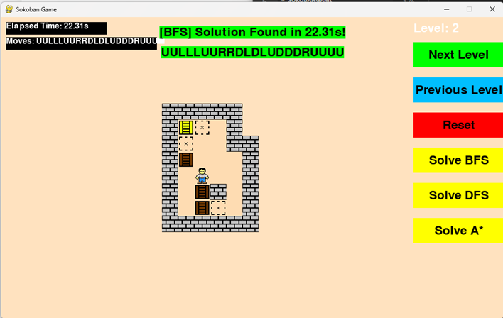
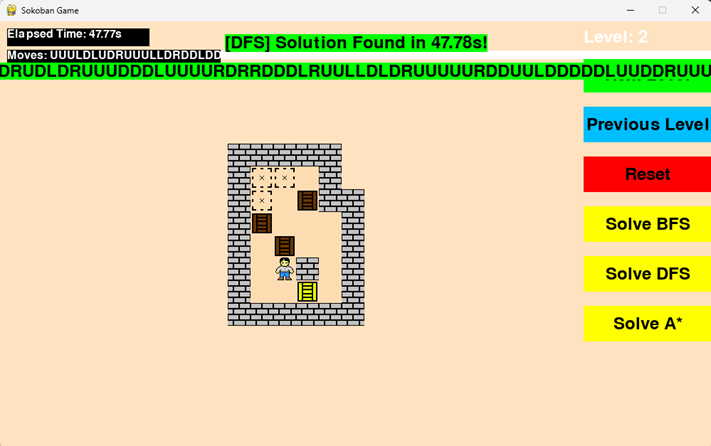
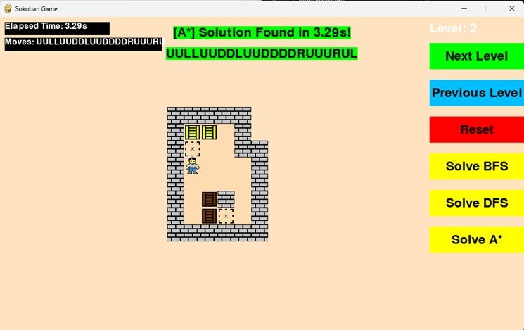

# Sokoban Game

A Python Sokoban puzzle you can solve yourself or with a built-in search that uses breadth-first search, depth-first search, or A*.

## Features

- Three warehouse levels, loaded from the `levels` file.
- Arrow-key play: walk onto open floor or a goal, and push a box when the cell beyond it is open floor or a goal.
- A level is complete when every box is on a goal (no loose `$` boxes and no empty `.` goals remain).
- Sidebar controls for the next level, the previous level, and reset. The current level number is shown above the buttons.
- After you finish a level, the game waits two seconds, then loads the next one. Finishing level 3 shows a win message and returns to level 1.
- **Solve BFS**, **Solve DFS**, and **Solve A\*** search for a solution, skip states where a box is stuck in a corner, and replay the moves on the board.
- While a search runs, the window shows elapsed time and the move string. When a solution is found, a banner shows the algorithm, the time, and the directions (`U`, `D`, `L`, `R`). The solver also prints the move list to the console.

## Tech stack

- Python 3
- [Pygame](https://www.pygame.org/) 2.1.0 (`requirements.txt`) for the window, sprites, and buttons
- The Python standard library for search (`collections.deque`, `heapq`, `copy`)

Sprites live in `images/` (`wall`, `floor`, `box`, `box_docked`, `dock`, `worker`, `worker_dock`). The window is 1000×600 and titled **Sokoban Game**; each tile is 32×32 pixels.

## Setup

Run these commands from a clone of this repository. The game loads `levels` and `images/` with paths relative to the working directory, so start it from the repository root. A display is required because Pygame opens a window.

```sh
git clone https://github.com/inasfarras/SokobanGame.git
cd SokobanGame
pip install -r requirements.txt
python sokoban.py
```

## Usage

| Input | Action |
| --- | --- |
| Arrow keys | Move the worker up, down, left, or right |
| Next Level | Load the next level, or return to level 1 after level 3 |
| Previous Level | Load the previous level (level 1 stays on level 1) |
| Reset | Reload the current level |
| Solve BFS | Search breadth-first, then replay the solution |
| Solve DFS | Search depth-first, then replay the solution |
| Solve A* | Search with the A* heuristic below, then replay the solution |
| Close the window | Quit |

Each solver resets the level before searching. If it finds a move list, it resets again and plays the moves back with a short pause between them. Breadth-first search expands states in order of move count. Depth-first search follows one path before backtracking, so its solution can be longer. A* orders states by the number of moves so far plus a heuristic: for each box that is off a goal, the Manhattan distance to the nearest goal that was empty when the search started, plus a penalty for every box off a goal and for boxes on the outer edge of the map. All three solvers drop a state when `DeadlockDetector` finds a box jammed in a corner.

### Level file

`levels` holds three maps. A line `Level N` starts a map, and a blank line ends it. `LevelManager` reads levels 1 through 3.

| Character | Meaning |
| --- | --- |
| `#` | Wall |
| ` ` (space) | Floor |
| `.` | Goal |
| `$` | Box |
| `*` | Box on a goal |
| `@` | Worker |
| `+` | Worker standing on a goal |

## Screenshots

Level 2 after **Solve BFS**, **Solve DFS**, and **Solve A\***:





## License

This project is licensed under the [MIT License](LICENSE). Copyright (c) 2026 Farras Inas.
